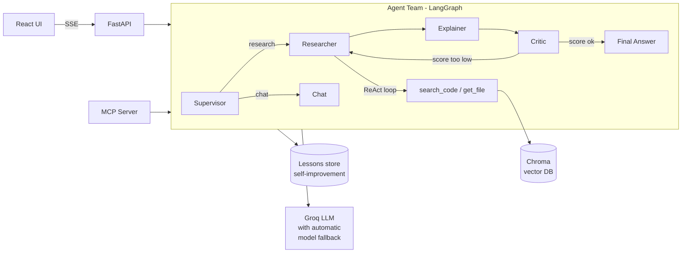
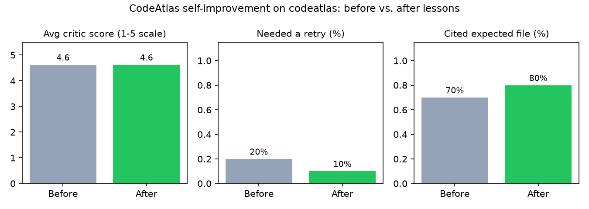
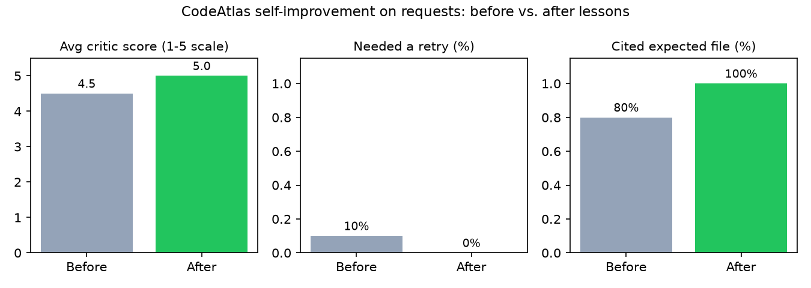

# CodeAtlas

[](https://github.com/vrynkov/codeatlas/actions/workflows/tests.yml)

**An AI team that reads a public GitHub repository's code and docs and answers questions about it, with citations you can check.**

Ask "How are retries handled?" about any indexed repo. A team of agents (built with LangChain and LangGraph) searches the actual code, reads it, writes an answer, and has a second agent check that answer against the evidence before you see it. The whole thing runs on free-tier infrastructure.

## Who it's for

Developers spend far more time reading code than writing it. CodeAtlas is like a senior teammate who has already read the entire repo and never gets tired of your questions. It helps in the situations every developer hits:

- **Day 1 at a new job:** a repo with 500 files, an outdated README, and the one person who understood it left last year.
- **A vague bug report:** "Payments fail sometimes." Where in the code do you even start?
- **Open source:** you want to contribute, but can't tell how the project is organized.
- **Code review:** you have to judge a change without knowing how the rest of the system works.

### Things you'd ask it

- "Where is user login handled, and which files are involved?"
- "The README says deployment uses Docker. Which code actually does it?"
- "This error appears in production: `KeyError: 'user_id'`. What's the likely cause?"
- "Where is the `Order` class used?"
- "Write a beginner-friendly summary of this project for a new teammate."

Every answer points to real files and line numbers, so you can check it instead of trusting blindly.

### Why not just search?

Plain search (Ctrl+F) finds exact words — search "login" and you miss `authenticate_user` or `session_start`. CodeAtlas searches by **meaning**: it's like asking a librarian for "a book about sad dogs" and getting the right book even if the title never says "sad" or "dog". It also connects the code with the repo's written docs (Markdown, reStructuredText and text files), so you don't have to cross-check them by hand.

**What it does not read (yet):** images and diagrams, GitHub issues and pull requests, commit history, and private repos. Python gets the most precise splitting (by function and class); other languages are split into fixed-size pieces.

### What it changes

| Without CodeAtlas | With CodeAtlas |
|---|---|
| Reading a new repo file by file | A starting point: which files matter, with links |
| Hunting for the right file | An answer with file and line links |
| Interrupting a senior colleague | Ask the tool first |
| Outdated docs nobody trusts | Answers come from the actual code |
| Slow reviews of unfamiliar code | Quick explanation of what a change touches |

## Why this exists

Most portfolio RAG projects are "upload a PDF, ask a question." This one is deliberately harder: it demonstrates hybrid retrieval, a real multi-agent pipeline with a self-critique loop, a self-improvement mechanism (measured honestly below: no clear effect yet), an MCP server other AI tools can plug into, and a measured evaluation — not just a demo that looks good once.

## Architecture



**The pipeline for one question:**
1. **Supervisor** — routes the question (is this about the repo's code, or just a greeting?)
2. **Researcher** — a hand-built ReAct agent: searches the code (hybrid: vector similarity + BM25 keyword search), reads files, decides when it has enough evidence
3. **Explainer** — turns the Researcher's findings into a clear, cited answer
4. **Critic** — independently scores the answer against the actual evidence (1-5); a low score sends it back for one retry with specific feedback
5. **Lessons** — when a retry was needed and then succeeded, what worked gets saved (for example, "in this repo, auth lives in `/services/auth`"); future similar questions get that as a hint (self-improvement without retraining anything)

## Tech stack

| Piece | Choice | Why |
|---|---|---|
| Agents | LangGraph + LangChain | Explicit control over the ReAct loop and multi-agent routing |
| LLM | Groq (`openai/gpt-oss-120b`, with automatic fallback) | Free tier, fast inference |
| Vector DB | Chroma | Local, free, no server to run |
| Search | Hybrid: sentence-transformers embeddings + BM25 (`rank-bm25`) | Catches both "retry logic" (concept) and "HTTPAdapter" (exact name) |
| Code parsing | Python `ast` | Chunks by function/class instead of arbitrary line windows |
| Backend | FastAPI, Server-Sent Events | Streams agent progress live to the browser |
| Frontend | React (Vite) | No framework bloat |
| Protocol | MCP (Model Context Protocol) | Other AI tools (Claude Desktop, MCP Inspector) can use CodeAtlas as a tool |
| Eval | Custom harness; 12 questions on CodeAtlas itself (plus an older 14-question `requests` set) | Pass rate, routing accuracy, critic score, citation checks, no-search baseline, self-improvement delta |

## Quick start

**Backend:**
```bash
cd backend
python -m venv .venv
.venv\Scripts\activate.bat        # Windows; use source .venv/bin/activate on Mac/Linux
pip install -r requirements.txt
cp .env.example .env              # then add your free Groq API key from console.groq.com
python -m app.indexing.indexer index https://github.com/vrynkov/codeatlas
uvicorn app.main:app --reload
```

**Frontend** (separate terminal):
```bash
cd frontend
npm install
npm run dev
```
Open the URL Vite prints, pick `codeatlas` from the left rail, and ask a question (for example "How does the critic decide whether to retry?").

**Run the tests** (offline and free: the AI model, GitHub and the embedding model are all replaced by fakes, so no API key or network is needed):
```bash
cd backend
pip install -r requirements-dev.txt
pytest
```
They cover the agent loop (retry, give-up, broken-review handling), model fallback, citation repair, the eval's scoring rules, and every abuse protection below. They also run on every push via GitHub Actions.

**Try the MCP server** (see [`scripts/mcp_client_demo.py`](backend/scripts/mcp_client_demo.py)):
```bash
cd backend
python scripts/mcp_client_demo.py codeatlas "How does the rate limiter work?"
```

## Evaluation results

### How the eval keeps itself honest

An eval that grades itself proves little, so:

- **A different model grades the answer.** The Critic always tries the model that wrote the answer last, even when the writer had fallen back to another model mid-question (`CRITIC_MODEL_CHAIN` and `avoiding()` in [`llm.py`](backend/app/agents/llm.py)). Only if every other model is rate limited does it grade with the same one, and the eval flags that answer as "self-graded".
  - **The trade-off:** the free chain has one large model (`gpt-oss-120b`), so when it writes, a smaller model grades. We accept that because the Critic's job is narrower than the writer's: it checks each claim against the code evidence pasted into its prompt, rather than answering from scratch. The alternative is a model grading its own work, which is worse. How often a stronger judge would disagree hasn't been measured yet.
- **A broken review is a fail.** If the Critic returns something unreadable (twice), the answer is shown to the user as *Unverified* and the eval counts it as a **fail**, never a pass. Misrouted questions and errors also stay in the totals.
- **Outside checks with no AI involved:** did the answer name the expected file and keyword, and does every `file:line` it cites really exist (the file is there and has those lines)?
- **A repo the models can't have memorized.** `psf/requests` is in every model's training data, so a good score there partly measures memory. CodeAtlas's own code (written in 2026, after these models were trained) is the second test set: [`eval/questions_codeatlas.json`](backend/eval/questions_codeatlas.json).
- **A no-search baseline.** [`eval/baseline.py`](backend/eval/baseline.py) asks the same questions to the same model with no search at all, and prints both side by side. The gap between the two is what the agents and search actually add.
- **A one-agent baseline.** [`eval/single_agent.py`](backend/eval/single_agent.py) asks the same questions to ONE ReAct agent with the same tools and model, but no Supervisor, Explainer, Critic or retry. Every setup also records tokens, model calls and seconds per question, so "is the team worth its extra cost?" has a number. [`eval/compare_setups.py`](backend/eval/compare_setups.py) prints all three side by side, only on questions every setup finished, plus a question-by-question tally. Results will be added here after the first real run.

```bash
python -m app.indexing.indexer index https://github.com/vrynkov/codeatlas
python -m eval.run_eval codeatlas --no-lessons   # the full team (no hints from earlier runs)
python -m eval.single_agent codeatlas            # one ReAct agent, no team
python -m eval.baseline codeatlas                # the same model, no search
python -m eval.compare_setups codeatlas          # one table for all three
# optional, needs `indexer index https://github.com/psf/requests` first:
python -m eval.baseline requests      # a famous repo: shows how much of a score is memory
```

### Results on CodeAtlas's own code (2026-11-10, two runs)

12 questions (10 about the code, 2 small-talk routing checks). These questions are about code no model has seen before. The team ran twice; where the two runs differ, both values are shown (run 1 / run 2). The no-search baseline ran once.

**Team vs. the same model with no search:**

| Outside check (no AI involved) | CodeAtlas team | Same model, no search |
|---|---|---|
| Named the expected file | **90% / 80%** | 10% |
| Cited the expected file as `file:line` | **90% / 70%** | 0% |
| Every cited `file:line` really exists | **100% / 100%** (59 / 48 citations) | 0% |
| Invented file paths (caught and labelled before display) | — / 1 | not filtered |
| Mentioned the expected keyword | 90% / 80% | 70% |

**The team's own scorecard:**

| Metric | Result |
|---|---|
| Passed review (a broken review, misroute or error counts as a fail) | 80% / 80% (8 of 10 both times) |
| Average critic score (over the 9 readable reviews) | 4.44 / 4.67 out of 5 |
| Needed a retry | 30% / 30% |
| Routing accuracy | 92% / 92% (11 of 12) |

**How to read this honestly:**
- **Search is what makes the answers checkable.** Without search, the model guesses believable answers but almost never names the right file, and none of its citations point to real lines.
- **Keyword checks are weak evidence.** The no-search model still hit 70%, because words like "score" or "lesson" are easy to guess. The file and citation checks are the ones that separate real answers from guesses.
- **The 100% "citations exist" is partly built in.** Before an answer is shown, the app turns any made-up file path into plain text marked "(not found in this repo)" ([`team.py`](backend/app/agents/team.py)), so those never reach the citation check. The eval counts them separately as "Invented file paths": 1 in run 2 (run 1 predates that counter). The line ranges still get a real check.
- **Free-tier conditions:** answers came from three models (run 1: gpt-oss-120b ×7, gpt-oss-20b ×3, qwen ×2; run 2: ×6, ×3, ×3) because of per-minute limits. In each run one answer was graded by the same model that wrote it, and the eval flags that.
- **Small sample, real variance:** 10 code questions, so one question is 10 points. Between two identical runs, "cited the expected file" moved from 90% to 70%. Treat these as ranges, not precise rates. The gap to the no-search baseline (0–10%) holds in both runs.

### Earlier results on `requests` (older, less strict eval)

Kept for history; the CodeAtlas results above are the ones to trust. Measured before the changes above (same model as Critic; a broken review was counted as a pass), on a 14-question set against `psf/requests` (10 code questions + 4 routing/chat checks), on `openai/gpt-oss-120b`:

| Metric | Result |
|---|---|
| Routing accuracy | 100% |
| Avg. Critic score | 4.6-4.8 / 5 |
| Needed a retry | 0-25%, run-dependent |
| Cited the correct file | 80% (after fixing a ground-truth error and a citation-format bug — see below) |
| Mentioned the correct file (any format) | 90-100% |

Reproduce it:
```bash
python -m eval.run_eval requests
python -m eval.compare_lessons requests   # measures the self-improvement effect specifically
python -m eval.make_chart requests        # renders a before/after chart
```

### Self-improvement, measured (CodeAtlas's own code, 2026-11-11)

Does the lessons memory actually help? [`compare_lessons.py`](backend/eval/compare_lessons.py) asks the same 10 code questions twice: **BEFORE** with all lessons cleared, then **AFTER** right away, so the lessons saved during the first pass are available. Both passes use the current, stricter eval (a different model grades, and a broken review counts as a fail).

| Metric | BEFORE (no lessons) | AFTER (with lessons) | Change |
|---|---|---|---|
| Passed review | 70% | 70% | same |
| Average critic score | 4.62 | 4.62 | same |
| Needed a retry | 20% | 10% | 1 fewer question |
| Cited the expected file as `file:line` | 70% | 80% | 1 more question |
| Mentioned the expected keyword | 70% | 80% | 1 more question |
| Every cited `file:line` really exists | 100% (52) | 100% (54) | same |
| Invented file paths (caught and labelled) | 2 | 1 | 1 fewer |
| Routing accuracy | 90% | 90% | same |
| Errors | 1 | 1 | same |
| Models that wrote the answers | 120b ×8, 20b ×2 | 120b ×6, 20b ×4 | AFTER used the smaller model more |



**Honest read: no clear effect yet.** Every change is exactly one question out of ten, and the two identical team runs above already moved by two questions (90% → 70%) on their own. So these differences are within normal run-to-run noise. Two things point the same way, but can't prove anything alone: nothing got worse, and AFTER did slightly better even though more of its answers came from the smaller model. Proving a real effect would need several runs, or more questions, on one model.

#### Earlier self-improvement runs on `requests` (older eval)

These four runs used the older eval (the Critic was the same model as the writer, and a broken review counted as a pass), on a repo the models have memorized. Kept for history:

| Run | Critic score | Retry rate | Citation accuracy |
|---|---|---|---|
| 1 | 4.70 → 5.00 (better) | 20% → 0% (better) | — |
| 2 | 5.00 → 4.62 (worse) | 0% → 12% (worse) | worse |
| 3 | 4.80 → 4.75 (~same) | 10% → 0% (better) | 70% → 100% (better) |
| 4 | 4.50 → 5.00 (better) | 10% → 0% (better) | 80% → 100% (better) |

Three of four runs show a net positive lean; one shows a net negative one. Chart from Run 4, the most complete recent one:



**Honest read:** the mechanism shows a real, if modest, positive lean across repeated testing — but every run shares the same confound (the AFTER pass usually completes fewer questions than BEFORE, since it starts right after BEFORE has already spent part of the day's quota, and the model actually answering sometimes changes mid-comparison as Groq's per-model limits shift). A single same-model, full-sample run under calm conditions is what would actually settle this with confidence. See "Known limitations" below for the specifics behind Run 2's regression.

### Measure, find, fix, measure again (2026-11-12 to 11-13)

Once the eval started recording tokens, model calls and seconds for each question, the first clean team run showed a problem the quality scores had hidden. I guessed at the cause, shipped two fixes, and measured again on fresh quota. **Neither fix worked.** Here is the record, because finding that out is the point of measuring.

| Team, 10 code questions, saved lessons off, fresh daily quota | Before ([run](backend/eval/results/codeatlas-20261112-083739.json)) | After both fixes ([run](backend/eval/results/codeatlas-20261113-094221.json)) |
|---|---|---|
| Cited the expected file | 70% | 80% |
| Citations that really exist | 100% (43) | 100% (45) |
| Input tokens per model call | 2,050 | 1,978 |
| Tokens / question | 18,254 | 23,912 |
| Model calls / question | 8.2 | 10.9 |
| Seconds / question (model actually working) | 48 (13) | 68 (19) |
| Answers written by the main model, `gpt-oss-120b` | 4 of 10 | 3 of 10 |
| Answers by a smaller model that `gpt-oss-120b` graded | 0 of 3 | 2 of 6 |
| Crashed with "request too large" | 1 | 2 |

**What the "before" run showed.** No model ran out for the day. The team sent so many tokens per minute that `gpt-oss-120b` kept hitting its per-minute limit, so the code switched to smaller backup models: 6 of 10 answers came from `gpt-oss-20b` or `qwen`. About 35 of every 48 seconds were spent waiting on rate limits. The extra agents cost more than tokens: they also pushed answers onto weaker models.

**My guesses, and the fixes.**
1. I assumed the ReAct loop's growing history was the main cost, since it resends old tool results on every step. So only the 2 newest tool results are now sent in full (`trim_history` in [`react_agent.py`](backend/app/agents/react_agent.py)).
2. When a backup model wrote the answer, a backup model also graded it. So the Critic now *starts* on the strongest model whenever that model isn't the writer (`avoiding()` in [`llm.py`](backend/app/agents/llm.py)).

**What "after" showed: both guesses were wrong.**
1. Input tokens *per call* did not move (2,050 to 1,978). The researcher's history was never the big cost. Each call is ~2K tokens whatever the step, and the Explainer and the Critic each re-read up to 9,000 characters of evidence. The cost comes from *how many calls* the team makes (8 to 11 per question), not from any single call growing.
2. The Critic does try `gpt-oss-120b` first now. But a smaller model writes the answer *because* `gpt-oss-120b` just hit its per-minute limit, so the Critic usually finds it still blocked and falls back too. Only 2 of 6 such answers got the big model as their judge. The fix is correct but treats a symptom. The cause is the same burst of calls.

The "cited the expected file" change (70% to 80%) is one question, which is within noise: identical runs have moved 20 points before. The same question can cost 6K tokens in one run and 37K in another, because a retry doubles it, so tokens per question is too noisy to compare. Tokens *per call* is the stable measure. (A third run, on 2026-11-12 after the morning run had used most of the quota, hit the daily limit partway through. It is kept [here](backend/eval/results/codeatlas-20261112-091904.json) for completeness, but it isn't used above.)

**What I'd change next.** Make fewer calls, rather than make each call smaller. The one-agent comparison ([`eval/single_agent.py`](backend/eval/single_agent.py)) tests the extreme version: no Supervisor, no Explainer and no Critic at all. A milder option is to wait for `gpt-oss-120b` to free up instead of switching models. That gives slower answers from the stronger model, which is a product trade-off.

## Known limitations (found by actually checking the work, not guessing)

- **Citation format varies.** The Explainer sometimes writes `file.py lines 123-456` instead of `file.py:123-456`; the eval's extractor was updated to catch both, but a still-rarer "file name and line number separated by unrelated prose" pattern isn't caught. See [`eval/harness.py`](backend/eval/harness.py).
- **A same-named-method mixup.** In one answer, the agent correctly identified `Session.send` handles the `verify` parameter, but cited a same-named abstract stub method instead of the real implementation ~600 lines later in the same file. At the time, name-based search didn't disambiguate multiple symbols sharing a name. (Since fixed: the [chunker](backend/app/indexing/chunker.py) now gives nested functions and class methods their own chunk with a qualified name like `Session.send`, and that name is part of the searchable text — see the project history.)
- **Very broad questions can hit a smaller fallback model's output limit.** A wide-open question like "What is this repository?" invites a long, comprehensive answer; on `qwen-3.8-27b` specifically (the last model in the fallback chain, with the tightest per-minute output ceiling of the three), this can exceed its limit and return a clear "try a shorter or more specific question" message rather than an answer. Rephrasing narrower (e.g. "Is RAG used in this repo?") resolves it immediately. See [`app/agents/llm.py`](backend/app/agents/llm.py).
- **Paraphrased questions can get a thinner answer.** The same underlying question asked in different words sometimes leads the Researcher to under-explore compared to the original phrasing, even though the answer given is still accurate.
- **Free-tier daily token quotas are real and tight.** `openai/gpt-oss-120b` and `openai/gpt-oss-20b` each get a separate 200K-token/day budget on Groq's free tier. CodeAtlas automatically falls back across a chain of models when one is exhausted ([`app/agents/llm.py`](backend/app/agents/llm.py)) and clearly reports the switch, but an eval run split across models mid-run is a real, disclosed constraint of building on free infrastructure, not a hidden one.
- **Reasoning models have hidden costs.** `openai/gpt-oss-120b` generates internal "thinking" tokens that count against quota even for a trivial prompt — a plain 1-token diagnostic probe is not actually free to run against it.
- **The self-improvement effect is not proven.** On CodeAtlas's own code, one comparison showed no change in pass rate or critic score and one-question gains elsewhere, which is within noise (see above). On the older `requests` runs, the one net-negative run (Run 2) had a notably small sample (4 vs. 8 fully-scored questions, since the BEFORE pass hit the daily quota early), a model change mid-experiment (`gpt-oss-20b` → `qwen-3.8-27b` as the day's quota shifted), and unusually heavy rate-limiting throughout — real free-tier conditions that make a clean comparison hard, not a flaw specific to that run alone (every run above has some version of this). A controlled re-test — one model, full sample, run when quota is fresh — is the next step toward a confident answer.

## Running it publicly: abuse protections

The demo server is open to anyone, so it defends itself (all limits are settings in [`config.py`](backend/app/config.py)):

- **Only public GitHub repos.** URLs must look like `https://github.com/<owner>/<repo>`; anything else (`file://`, other hosts, `--option` tricks, `..`) is refused before git runs, and the clone URL is rebuilt from the checked parts.
- **Size caps.** GitHub's API size is checked before downloading, the clone has a time limit, the downloaded size is checked again, and repos with too many code chunks to embed are refused. Only one repo indexes at a time.
- **No silent replacement.** `github.com/someone-else/codeatlas` can't overwrite the indexed `vrynkov/codeatlas`, because folders are named by repo name.
- **Rate limits per visitor** (in memory, free): a few questions per minute and per day, a few new repos per hour. This works because the app runs as a single instance (`--max-instances=1`); it resets on restart.
- **No prompt injection through feedback.** Lessons are pasted into future prompts, so they're built only from fixed sentences and file paths that really exist in the repo. Search words are not stored: they are model text a question can steer, and plain words pass any character filter. Feedback is a yes/no rating only: the API refuses any free-text field, so there is no typed text to leak into a prompt. Feedback is accepted only for an answer the server actually gave (looked up by its request id), once.

## Project structure

```
backend/
  app/
    agents/       # LangGraph team: supervisor, researcher (ReAct), explainer, critic, model fallback
    api/          # FastAPI routes (SSE streaming, feedback, repo indexing)
    indexing/     # Clone -> chunk (by function/class) -> embed -> store
    memory/       # Self-improvement "lessons" store
    tools/        # Hybrid search, safe file reading
    mcp_server.py # Exposes the same capabilities over MCP
  eval/           # Question sets, scoring harness, no-search and one-agent baselines, comparisons, charting
  tests/          # Offline pytest suite (fake model, no network)
frontend/
  src/            # React UI: repo picker, chat, live agent trace log
```

**Key files, linked for quick navigation** (GitHub won't make the tree above clickable, since it's a code block):
- [`app/agents/team.py`](backend/app/agents/team.py) — the LangGraph team: Supervisor, Researcher, Explainer, Critic, and the retry loop
- [`app/agents/react_agent.py`](backend/app/agents/react_agent.py) — the hand-built ReAct loop the Researcher runs
- [`app/agents/llm.py`](backend/app/agents/llm.py) — automatic model fallback across Groq's daily/short-term rate limits
- [`app/tools/search.py`](backend/app/tools/search.py) — hybrid (vector + BM25) code search
- [`app/indexing/chunker.py`](backend/app/indexing/chunker.py) — splits a repo into function/class-level chunks using Python's `ast`
- [`app/memory/lessons.py`](backend/app/memory/lessons.py) — the self-improvement "lessons" store
- [`app/mcp_server.py`](backend/app/mcp_server.py) — exposes CodeAtlas as an MCP server
- [`app/api/routes.py`](backend/app/api/routes.py) — the FastAPI endpoints the React UI calls
- [`eval/harness.py`](backend/eval/harness.py) and [`eval/run_eval.py`](backend/eval/run_eval.py) — the evaluation scoring logic
- [`frontend/src/ChatPanel.jsx`](frontend/src/ChatPanel.jsx) — the chat UI, streaming, and Stop button

## Running with Docker

**Test the production container locally first:**
```bash
docker compose up --build
```
This builds the React frontend, packages it with the FastAPI backend into one image (see the [`Dockerfile`](Dockerfile)), and serves everything from `http://localhost:7860`. On first boot, [`docker-entrypoint.sh`](docker-entrypoint.sh) automatically pre-indexes CodeAtlas itself (`vrynkov/codeatlas`) so there's something to try immediately. You still need a `backend/.env` (copy [`backend/.env.example`](backend/.env.example) and add your `GROQ_API_KEY`) — [`docker-compose.yml`](docker-compose.yml) reads it at container start; it is never baked into the image (see [`.dockerignore`](.dockerignore)).

## Deployment (Google Cloud Run)

CodeAtlas is deployed on **Google Cloud Run**: [live demo ↗](https://codeatlas-705750337383.us-central1.run.app)

### Deploy it yourself

1. **Enable the required APIs** (one-time, per GCP project):
```bash
gcloud services enable run.googleapis.com cloudbuild.googleapis.com
```
2. **Store your Groq API key as a secret:**
```bash
gcloud secrets create groq-api-key --data-file="path\to\your\key.txt"
gcloud secrets add-iam-policy-binding groq-api-key
--member="serviceAccount:YOUR_PROJECT_NUMBER-compute@developer.gserviceaccount.com"
--role="roles/secretmanager.secretAccessor"
```
3. **Deploy:**
```bash
gcloud run deploy codeatlas --source . --port 7860 --region us-central1
--allow-unauthenticated --memory 2Gi --timeout=1800
--set-secrets=GROQ_API_KEY=groq-api-key:latest --no-cpu-throttling --max-instances=1
```

### Why these flags matter

- `--memory 2Gi` — the default 512Mi causes out-of-memory crashes during indexing.
- `--timeout=1800` — Cloud Run's default 5-minute request timeout is too short for indexing larger repos.
- `--no-cpu-throttling` — **required**. Cloud Run throttles CPU to near-zero once a request finishes by default, which silently kills the background indexing thread midway through. This cost real debugging time: indexing worked perfectly locally but died unpredictably in production until this flag was found.
- `--max-instances=1` — **required**. Indexing progress lives in the server's memory and the Chroma store lives on its local disk, so every request must reach the same copy of the app. With two or more copies, the UI's progress polling can land on a copy that never started the job and gets `404 No indexing job found`, and a repo indexed on one copy is missing on the others.

### Known limitation

`data/` (the Chroma vector store) is **ephemeral** — it's wiped on redeploy or when Cloud Run scales an idle instance down to zero. Only the repo indexed by `docker-entrypoint.sh` on container boot (`vrynkov/codeatlas`, by default) survives automatically. Repos added manually through the UI will disappear after a scale-down. Setting `gcloud run services update codeatlas --region us-central1 --min-instances=1` keeps an instance warm (at a small ongoing cost) if persistence matters for a demo.


## Logging and tracing

CodeAtlas writes its logs as JSON lines (one event per line) and can send traces to two free services,
so a separate tool (for example PagePal) can work out what went wrong in a run.

| What | Where it goes | Free tier | Switched on by |
|---|---|---|---|
| JSON logs ([`logging_setup.py`](backend/app/logging_setup.py)) | stderr -> Cloud Logging | 50 GiB / month | always on |
| Request + LLM-call spans ([`tracing_setup.py`](backend/app/tracing_setup.py)) | Cloud Trace | 2.5M spans / month | `CLOUD_TRACE_ENABLED=true` |
| Agent-by-agent traces (prompts, tool calls, answers) | LangSmith | 5k traces / month | `LANGSMITH_TRACING=true` + key |

Every log line written while handling one request carries the same `request_id`, and in the
cloud also `logging.googleapis.com/trace`, so Cloud Logging can open the matching trace. The `/ask`
stream's `request_id` also goes into the LangSmith run's metadata, so a question can be followed
across all three.

Main events: `request_finished`, `team_run_started` / `team_run_finished` / `team_run_stopped` / `team_run_failed`,
`llm_call` (model, duration, tokens), `tool_called`, `rate_limited`, `model_fallback`, `all_models_exhausted`,
`indexing_started` / `indexing_progress` / `indexing_done` / `indexing_failed`, `git_failed`.

Locally, logs are printed as readable text. Set `LOG_FORMAT=json` in `backend/.env` to see the exact cloud format.

### Switch it on in Cloud Run

```bash
gcloud services enable cloudtrace.googleapis.com
gcloud projects add-iam-policy-binding YOUR_PROJECT_ID
--member="serviceAccount:YOUR_PROJECT_NUMBER-compute@developer.gserviceaccount.com"
--role="roles/cloudtrace.agent"

gcloud secrets create langsmith-api-key --data-file="path\to\your\langsmith-key.txt"
gcloud secrets add-iam-policy-binding langsmith-api-key
--member="serviceAccount:YOUR_PROJECT_NUMBER-compute@developer.gserviceaccount.com"
--role="roles/secretmanager.secretAccessor"

gcloud run services update codeatlas --region us-central1
--update-env-vars=CLOUD_TRACE_ENABLED=true,GOOGLE_CLOUD_PROJECT=YOUR_PROJECT_ID,LANGSMITH_TRACING=true,LANGSMITH_PROJECT=codeatlas
--update-secrets=LANGSMITH_API_KEY=langsmith-api-key:latest
```

During a load test, add `LANGSMITH_TRACING_SAMPLING_RATE=0.1` and `CLOUD_TRACE_SAMPLE_RATE=0.1` so only
10% of requests are traced and the free LangSmith quota lasts.

Note: lessons (the self-improvement memory) live in the same `data/` folder, so they are wiped too
when Cloud Run scales to zero (see the known limitation above).

## What I'd build next

- Multimodal support: index architecture diagrams and screenshots in a repo's docs (CLIP embeddings), not just text
- Persistent storage so an indexed repo survives a Cloud Run redeploy or scale-down to zero

## License

MIT
